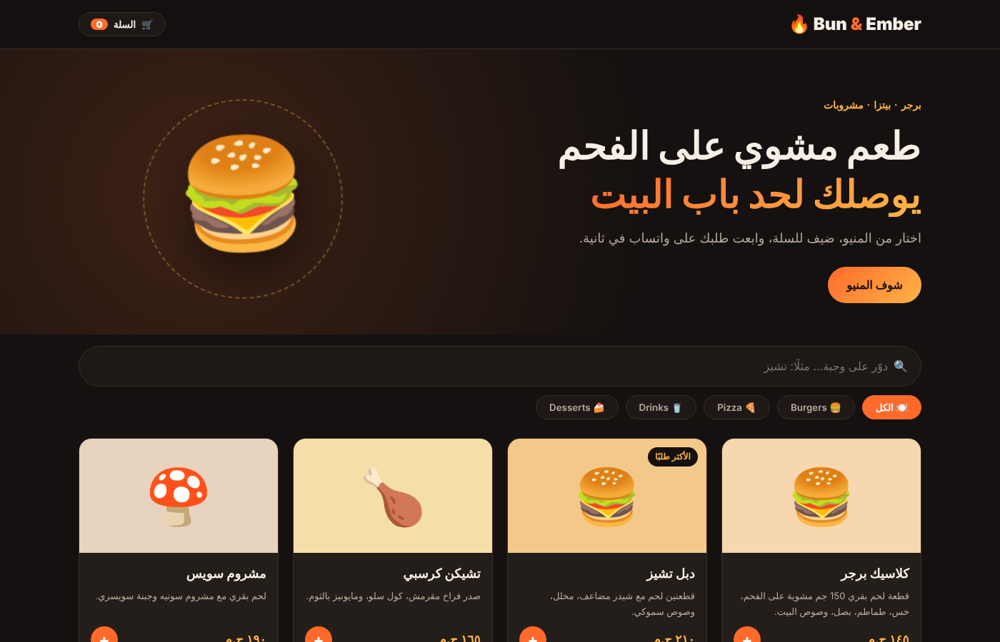

# Digital Restaurant Menu (Demo)

A responsive Arabic (RTL) digital menu for a fictional burger restaurant, built with plain HTML5, CSS3 and JavaScript ES6+ (no frameworks, no backend).

**Live demo:** https://saifaboalnaga.github.io/restaurant-menu-demo/

## Features
- Menu split into categories (Burgers, Pizza, Drinks, Desserts) with photos/icons, names, prices and descriptions
- Live search and category filtering
- Product details modal with quantity picker
- Shopping cart: add, remove, change quantities, running total; saved in the browser so it survives a page reload
- One-tap order via WhatsApp with a pre-filled message (items, quantities, total, notes)
- Responsive on mobile, tablet and desktop; simple animations and hover effects

## Editing the menu
All products, prices and the WhatsApp number live in `products.js`, so the owner can update the menu without touching the rest of the code.

The restaurant, products and WhatsApp number are placeholders for demonstration only.

Built by Saif Aboalnaga.
